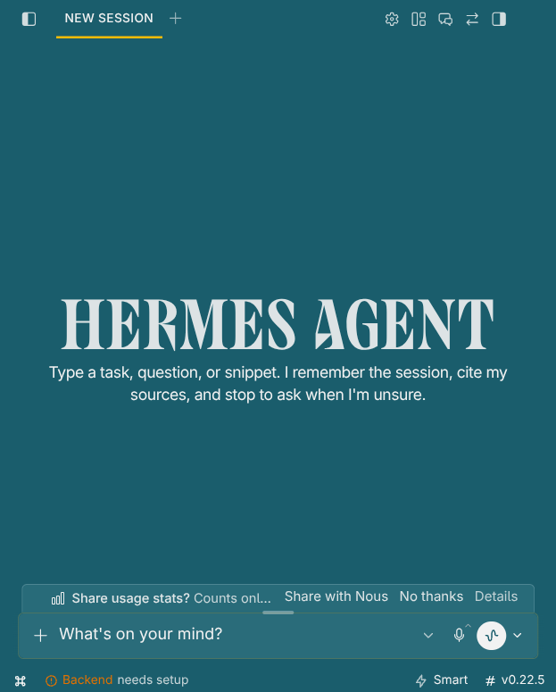

# Wallaby for Hermes Desktop

A standard **built-in desktop theme** port of Wallaby: teal surfaces, gold highlights,
and light foreground text. The upstream palette is kept in both Light and Dark
modes rather than inventing a separate light variant. Layout and typography remain
Hermes defaults.



## Opaque, without blur

- Solid window, sidebar, composer, menu, settings overlay, and dialog surfaces.
- No CSS backdrop blur or filters while Wallaby is selected.
- Native Electron window opacity is 1; the theme temporarily suppresses window
  fade and glass without overwriting the user's saved translucency preferences.
- Switching to another theme removes Wallaby's CSS and restores those preferences.
- Registered through Hermes's normal `BUILTIN_THEMES` list; no plugin or alternate
  theme selector is needed.

This directory contains a **Hermes source patch**, not a drop-in CLI YAML skin.
The Python CLI and separate web dashboard have not been ported.

## Install into a source checkout

Tested Hermes base: [`bf0203a794a07aac3ff764972ab9087baa4e4f4e`](https://github.com/NousResearch/hermes-agent/commit/bf0203a794a07aac3ff764972ab9087baa4e4f4e).
Download/clone this repository, then from the root of your Hermes source checkout:

```sh
# Replace /path/to/Wallaby_Themes with your clone's actual path.
git apply --check /path/to/Wallaby_Themes/Hermes/wallaby.patch
git apply /path/to/Wallaby_Themes/Hermes/wallaby.patch

# Run after saving work and closing every Hermes Desktop window.
# This command can stop a running desktop during package promotion.
hermes desktop --build-only
hermes desktop
```

Select **Settings → Appearance → Theme → Wallaby** in the rebuilt app.
Existing windows do not pick up source or `dist/` changes until the new build loads.
For a non-default source location, use that checkout's Hermes launcher; do not
accidentally rebuild a different installation. The patch is version-dependent:
if `git apply --check` reports conflicts, stop and port/review the changes rather
than forcing them or discarding local edits. No upstream installer is executed.

To remove, select another theme, close Desktop, run
`git apply --reverse --check /path/to/Wallaby_Themes/Hermes/wallaby.patch`, then
`git apply --reverse /path/to/Wallaby_Themes/Hermes/wallaby.patch`, and rebuild.

## Source and scope

Palette source: `KDE Plasma/color-schemes/Wallaby.colors` and the surface ladder
in this repository, revision `069a43b76e4ce29e4a5dd4184c6929f87a5247d0`.
Original Wallaby design: [Jeremie Tamburini (@jeremie2)](https://github.com/jeremie2/Wallaby).
The patch includes Hermes-derived code; Hermes's upstream licensing still applies
([NousResearch/hermes-agent](https://github.com/NousResearch/hermes-agent)).

| Role | Color |
| --- | --- |
| Background / sidebar | `#1a5d6c` |
| Card / composer | `#2a6c7a` |
| Raised surface / input | `#347483` |
| Button | `#488693` |
| Hover / border | `#5f93a0` |
| Selection / primary / focus ring | `#ffbc03` |
| Main text | `#f2f2f2` |
| Muted text | `#c6c6c6` |
| Error | `#fda1a0` |

The patch changes seven paths: the shared palette, desktop preset registration,
theme interface/application, effective translucency resolver, and two regression
test files. It excludes unrelated local Kanban changes.

## Verification

On Linux / KDE Wayland with Electron 44.9.3:

```sh
cd apps/desktop
npx vitest run --project ui src/themes src/store/translucency.test.ts src/store/translucency.win10.test.ts
# 15 files / 178 passed
npx vitest run --project electron electron/translucency.test.ts
# 1 file / 74 passed
npx tsc -p . --noEmit
# passed
npm run build
# passed (optional XInput2.h HUD-helper and existing Vite warnings remain)
```

Real isolated Electron checks exercised normal theme selection, persistence after
reload, chat/composer, attachment menu, URL dialog, light/dark modes, native
opacity 1, zero visible CSS blur/filter, and restoration on switching away.
Screenshots use an isolated empty profile, not personal conversations.

This is not exhaustive cross-platform or accessibility certification. Real model
streaming, populated terminal/HUD/pet/plugin surfaces, macOS and Windows visuals,
and compositor rules external to Hermes were not audited.
